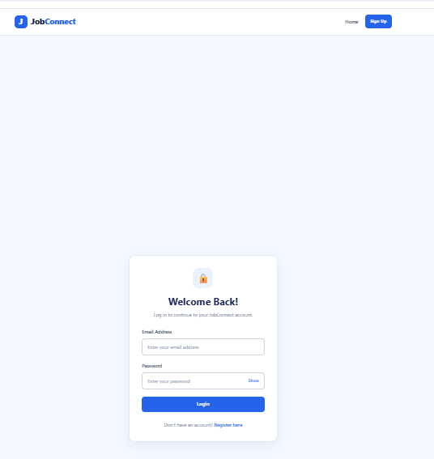
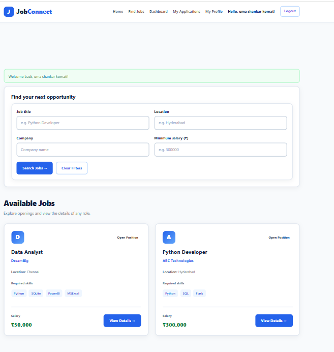

# JobConnect – Online Job Portal

A web-based job portal built with **Python, Flask, Oracle Database, HTML, CSS, and JavaScript** that connects job seekers with employers through a simple and user-friendly interface.

JobConnect helps candidates discover job opportunities, manage their profiles, upload resumes, and track applications. Employers can post jobs, review applications, and manage candidates.

## Features

### 👨‍💻 For Job Seekers
- User registration and secure login
- Browse available job listings
- View detailed job descriptions
- Apply for job opportunities
- Upload and manage resumes
- Create and update profile information
- Track job application status
- Receive notifications
- Discover recommended jobs based on skills
- Change account password

### 🏢 For Employers
- Employer registration and login
- Employer dashboard
- Post and manage job listings
- View applications submitted by candidates
- Review candidate details
- Manage applications and candidate status
- Monitor recruitment statistics

### 🔐 General Features
- Responsive blue-and-white user interface
- Form validation and error handling
- Oracle Database integration
- Separate dashboards for job seekers and employers
- Organized Flask templates and static assets

## Technology Stack

| Technology | Purpose |
|---|---|
| Python | Backend programming |
| Flask | Web application framework |
| Oracle Database | Data storage |
| HTML5 | Web page structure |
| CSS3 | Styling and responsive UI |
| JavaScript | Client-side interactivity |
| Git and GitHub | Version control and source code hosting |

## Project Structure

```text
JobConnect/
├── app.py
├── database.py
├── test_db.py
├── requirements.txt
├── .gitignore
├── README.md
├── static/
│   └── css/
│       └── style.css
└── templates/
    ├── base.html
    ├── index.html
    ├── login.html
    ├── register.html
    ├── jobs.html
    ├── job_details.html
    ├── job_seeker_dashboard.html
    ├── employer_dashboard.html
    ├── employer_applications.html
    ├── my_applications.html
    ├── profile.html
    ├── upload_resume.html
    ├── notifications.html
    ├── recommended_jobs.html
    └── change_password.html
```


## Prerequisites

Before running the project, make sure you have:

- Python 3.10 or a compatible version
- Oracle Database access
- An Oracle database user with the required permissions
- Oracle client libraries if required by your database driver
- Git (optional, for cloning the repository)

## Installation and Setup

### 1. Clone the repository

```bash
git clone https://github.com/komatiuma25/JobConnect.git
cd JobConnect
```

### 2. Create a virtual environment

On Windows:

```powershell
python -m venv venv
```

Activate it:

```powershell
.\venv\Scripts\Activate.ps1
```

If you use Command Prompt instead of PowerShell:

```cmd
venv\Scripts\activate
```

### 3. Install dependencies

```bash
python -m pip install --upgrade pip
pip install -r requirements.txt
```

### 4. Configure Oracle Database

1. Start or connect to your Oracle Database instance.
2. Create or select a database user with the permissions required by the application.
3. Configure the database username, password, host, port, and service name according to the connection code in `database.py`.
4. Ensure that the required tables and database objects exist.

**Important:** Do not upload database passwords, private connection details, or other secrets to GitHub. Use environment variables or a local configuration file excluded by `.gitignore` where appropriate.

### 5. Verify the database connection

If `test_db.py` is configured as your database connection test, run:

```bash
python test_db.py
```

Resolve any connection or configuration errors before starting the application.

### 6. Run the Flask application

```bash
python app.py
```

Open the local address displayed in your terminal, commonly:

```text
http://127.0.0.1:5000
```

The actual address and port depend on your Flask configuration.

## Screenshots

Add screenshots of your application's main pages to a `screenshots/` folder in the project root. You can then display them here.

### Home Page


### Login Page



### Job Listings



### Job Seeker Dashboard


### Employer Dashboard


*Replace these example image paths with the actual filenames of your screenshots.*

## Future Enhancements

Potential improvements for future versions include:

- Email notifications for application updates
- Advanced job search and filtering
- Pagination for job listings
- Improved matching between candidate skills and job requirements
- Automated deployment and production configuration

## Learning Outcomes

This project provides practical experience with:

- Building a web application using Flask
- Connecting Python applications to Oracle Database
- Implementing user authentication and role-based pages
- Working with HTML, CSS, and JavaScript
- Organizing templates and static assets
- Using Git and GitHub for version control

## Author

**JobConnect Project**

GitHub Repository: [komatiuma25/JobConnect](https://github.com/komatiuma25/JobConnect)

## License

This project is available for educational and portfolio purposes. Add a `LICENSE` file to the repository if you want to specify formal usage and distribution terms.
